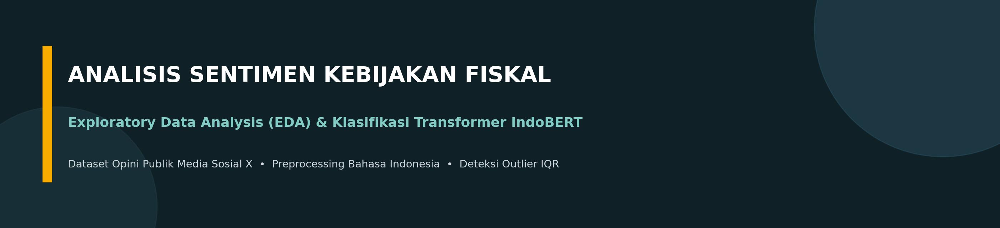

# Analisis Sentimen Opini Publik terhadap Kebijakan Fiskal di Media Sosial X

**Web Scraping, Exploratory Data Analysis (EDA), dan Klasifikasi Sentimen Berbasis Pre-Trained Transformer (IndoBERT)**

_Scraping Opini Publik Media Sosial X · Text Preprocessing Bahasa Indonesia · Deteksi Outlier (IQR) · Fine-Tuning IndoBERT_

[](https://www.python.org/)
[](https://pytorch.org/)
[](https://huggingface.co/indobenchmark/indobert-base-p1)
[](DataTwitter_Purbaya_Fiskal.xlsx)
[](https://colab.research.google.com/github/haninurul792/DataScience/blob/main/Scraping%20EDA.ipynb)
[](https://colab.research.google.com/github/haninurul792/DataScience/blob/main/EDA_Sentimen_Kebijakan_Fiskal_X_IndoBERT_Lengkap.ipynb)

[Ringkasan](#ringkasan-proyek) · [Latar Belakang](#latar-belakang-dan-tujuan) · [Temuan EDA](#temuan-utama-eda) · [Galeri Visualisasi](#galeri-visualisasi-eda) · [Metodologi](#alur-dan-metodologi) · [Evaluasi Model](#evaluasi-model-indobert) · [Dokumen & Repo](#dokumen-dan-artefak-proyek) · [Tutorial](#tutorial-menjalankan-proyek)

> [!IMPORTANT]
> Seluruh data pada repositori ini (`DataTwitter_Purbaya_Fiskal.xlsx`) dikumpulkan melalui proses *scraping* opini publik terbuka di media sosial **X (Twitter)** terkait diskursus kebijakan fiskal pada masa jabatan Menteri Keuangan Purbaya Yudhi Sadewa. Dataset telah melewati proses **anonimisasi identitas akun** dan pembersihan teks untuk kepentingan riset akademik Mata Kuliah Data Science.

---

## Ringkasan Proyek

Diskursus kebijakan fiskal pemerintah—seperti pengelolaan anggaran negara (APBN), kebijakan perpajakan, subsidi, dan stimulus ekonomi—menghasilkan arus opini publik yang dinamis di media sosial **X**. Namun, data teks media sosial memiliki karakteristik tidak terstruktur, penuh singkatan, bahasa gaul, serta nuansa sarkasme yang sering gagal dipahami oleh pendekatan analisis berbasis leksikon maupun statistik kata konvensional.

Repositori ini mendokumentasikan alur *end-to-end* mulai dari **pengumpulan data (*Web Scraping*) dan eksplorasi awal** pada notebook [`Scraping EDA.ipynb`](Scraping%20EDA.ipynb), dilanjutkan dengan **Exploratory Data Analysis (EDA) mendalam, deteksi pencilan (*outlier*), serta klasifikasi sentimen berbasis Transformer (IndoBERT)** pada notebook [`EDA_Sentimen_Kebijakan_Fiskal_X_IndoBERT_Lengkap.ipynb`](EDA_Sentimen_Kebijakan_Fiskal_X_IndoBERT_Lengkap.ipynb).

| Komponen Penelitian | Spesifikasi & Keterangan |
| :--- | :--- |
| **Domain & Objek** | Opini publik media sosial X terhadap kebijakan fiskal nasional |
| **Tahap 1 — Akuisisi Data** | Web Scraping cuitan media sosial X ([`Scraping EDA.ipynb`](Scraping%20EDA.ipynb)) |
| **Sumber Dataset** | [`DataTwitter_Purbaya_Fiskal.xlsx`](DataTwitter_Purbaya_Fiskal.xlsx) |
| **Tahap 2 — EDA & Pemodelan** | Pembersihan teks, analisis distribusi, korelasi Spearman, deteksi outlier (IQR), & Fine-Tuning **IndoBERT** ([`EDA_Sentimen_Kebijakan_Fiskal_X_IndoBERT_Lengkap.ipynb`](EDA_Sentimen_Kebijakan_Fiskal_X_IndoBERT_Lengkap.ipynb)) |
| **Ekosistem Pustaka** | `pandas`, `openpyxl`, `numpy`, `matplotlib`, `seaborn`, `wordcloud`, `scikit-learn`, `torch`, `transformers` |

---

## Latar Belakang dan Tujuan

1. **Akuisisi Data Opini Publik Terarah (*Targeted Scraping*):** Mengumpulkan korpus cuitan berbahasa Indonesia yang relevan dengan wacana kebijakan fiskal dan perpajakan di media sosial X sebagai fondasi empiris penelitian.
2. **Pemetaan Kualitas & Struktur Data Teks (EDA):** Mengidentifikasi nilai hilang (*missing values*), kemiringan distribusi (*skewness & kurtosis*), korelasi antarvariabel (*Spearman*), serta anomali panjang teks (*outlier IQR*) sebelum memasuki tahap pemodelan *deep learning*.
3. **Klasifikasi Sentimen Kontekstual dengan IndoBERT:** Memanfaatkan mekanisme *self-attention* dua arah (*bidirectional*) dan tokenisasi sub-kata (*WordPiece*) pada **IndoBERT** untuk menangkap istilah teknis ekonomi/fiskal serta struktur kalimat tidak baku di media sosial.

---

## Temuan Utama EDA

Seluruh proses pengumpulan data, inspeksi statistik, pembersihan teks, dan pelatihan model terdokumentasi di dalam kedua notebook pada repositori ini.

| Dimensi Analisis | Temuan & Metode | Implikasi Pemodelan |
| :--- | :--- | :--- |
| **Akuisisi & Korpus Data** | Pengumpulan cuitan melalui [`Scraping EDA.ipynb`](Scraping%20EDA.ipynb) dan penyimpanan terstruktur ke [`DataTwitter_Purbaya_Fiskal.xlsx`](DataTwitter_Purbaya_Fiskal.xlsx). | Menyediakan dataset domain-spesifik kebijakan fiskal berbahasa Indonesia. |
| **Pemeriksaan Missing Values** | Audit jumlah dan persentase data kosong pada setiap kolom (`01 Tabel jumlah dan persentase missing.jpg`). | Menjamin tidak ada baris teks kosong yang masuk ke dalam proses tokenisasi. |
| **Distribusi, Skewness & Transformasi** | Analisis *Skewness & Kurtosis* serta penerapan *Log Transformation* (`np.log1p`) pada variabel numerik interaksi. | Menormalkan distribusi fitur pendukung yang miring ekstrem (*right-skewed*). |
| **Korelasi Non-Parametrik & Outlier** | Uji **Korelasi Spearman** dan deteksi pencilan metode **IQR** pada jumlah kata (`word_count`) dan interaksi (`favorite_count`). | Menjadi dasar empiris penentuan batas panjang urutan (*`max_length`*) pada tokenizer IndoBERT. |

---

## Galeri Visualisasi EDA

Seluruh grafik hasil analisis diekspor dalam resolusi tinggi ke dalam folder [`Output/`](Output/) dan ditautkan langsung di bawah ini:

| 1. Audit Missing Values | 2. Analisis Skewness & Kurtosis |
| :---: | :---: |
|  |  |

| 3. Penerapan Log Transformation | 4. Distribusi Fitur Numerik & Teks |
| :---: | :---: |
|  |  |

| 5. Perbandingan Distribusi Lanjutan | 6. Matriks Korelasi Spearman |
| :---: | :---: |
|  |  |

| 7. Deteksi Outlier Panjang Teks & Likes (IQR Series) |
| :---: |
|  |

---

## Alur dan Metodologi

```text
┌─────────────────────────────────────────────────────────────────┐
│  1. DATA SCRAPING & INITIAL EDA (Scraping EDA.ipynb)            │
│     • Pengumpulan cuitan opini publik dari media sosial X       │
│     • Inspeksi struktur awal & ekspor ke Excel (.xlsx)          │
└────────────────────────────────┬────────────────────────────────┘
                                 ▼
┌─────────────────────────────────────────────────────────────────┐
│  2. TEXT PREPROCESSING & DATA QUALITY AUDIT                     │
│     • Audit missing values, hapus duplikasi, URL, & mention     │
│     • Case folding & normalisasi teks bahasa Indonesia          │
└────────────────────────────────┬────────────────────────────────┘
                                 ▼
┌─────────────────────────────────────────────────────────────────┐
│  3. EXPLORATORY DATA ANALYSIS (EDA) STATISTIK & VISUAL          │
│     • Skewness, Kurtosis, Log Transformation, & Korelasi Spearman│
│     • Deteksi outlier IQR (word_count & favorite_count)         │
└────────────────────────────────┬────────────────────────────────┘
                                 ▼
┌─────────────────────────────────────────────────────────────────┐
│  4. TOKENIZATION & DATA SPLITTING                               │
│     • IndoBERT WordPiece Tokenizer ([CLS], [SEP], Attention Mask)│
│     • Pembagian Stratified Train / Validation / Test Set        │
└────────────────────────────────┬────────────────────────────────┘
                                 ▼
┌─────────────────────────────────────────────────────────────────┐
│  5. FINE-TUNING INDOBERT & EVALUATION                           │
│     • Pelatihan klasifikasi berbasis PyTorch / Hugging Face     │
│     • Evaluasi Accuracy, Precision, Recall, F1 & Confusion Matrix│
└─────────────────────────────────────────────────────────────────┘
